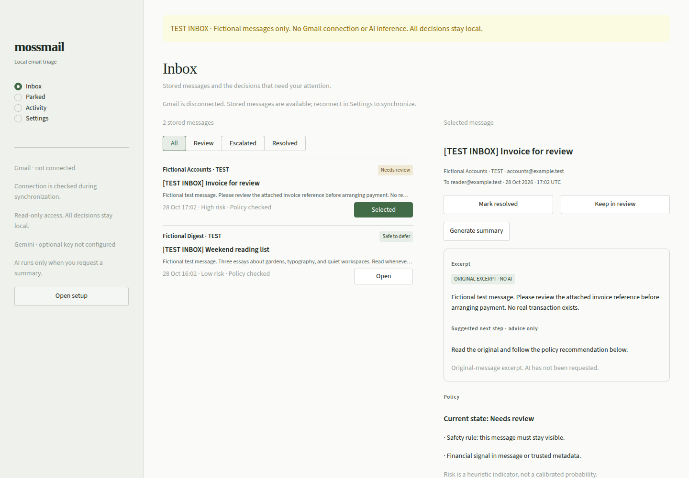

# MossMail

**Read-only Gmail triage with transparent rules and local decisions.**

MossMail is a local-first email triage assistant. Import up to 20 recent Gmail inbox messages at a time, inspect rule-based recommendations, and record what needs review, what can wait, and what you have resolved. AI summaries and durable background timers are optional integrations configured separately. Nothing is sent, drafted, deleted, archived, labeled, or marked read in Gmail.

## See it in a minute

[](docs/mossmail-demo-current.mp4)

**[Watch the 60-second walkthrough](docs/mossmail-demo-current.mp4)** · [What the recording demonstrates](docs/demo.md)

The recording shows the actual local application: optional setup, an empty first run, a labeled test inbox, policy explanations, local parking, resolution, and decisions surviving a reload. All messages are fictional. No Gmail connection, AI inference, or Temporal service is used in this recording.

The [hosted landing page](https://mossmail.streamlit.app/) presents the recording and local setup instructions. It is not an interactive mailbox. Reviewing your own mail requires a local installation and your own Google OAuth configuration.

## Default behavior and optional integrations

- **Fresh installation:** an empty inbox and dismissible setup; no account or AI key is required to open the app.
- **With Gmail connected:** manual, read-only imports, deterministic policy explanations, original-message excerpts, and persisted local review, resolve, and park decisions. You still handle the underlying email yourself.
- **Optional summaries:** Gemini with your key, or a separately installed Ollama model, only when you request a summary. AI cannot authorize a policy decision.
- **Optional background timers:** a separate Temporal server, worker, and CLI. The normal UI checks local deadlines when the app runs.

There is no measured classification accuracy or time-saving claim. Risk scores are heuristics, and this remains a single-user local tool.

## Run locally

Requires Python 3.12+. The app uses the runtime requirements below; contributor tests and screenshot tooling use the separate `requirements-dev.txt`.

```bash
git clone https://github.com/GhananilShirpurkar/mossmail.git
cd mossmail
python3 -m venv .venv
source .venv/bin/activate
python -m pip install -r requirements.txt
streamlit run app.py --server.address 127.0.0.1
```

The welcome screen offers **Set up now**, **Skip for now**, and **Close setup**. Skipping or closing is remembered in the local database. Reopen it from Settings or **Open setup** in the sidebar. You can skip either integration and choose **Finish setup** without credentials. Finishing means leaving setup, not verifying every integration.

A fresh installation has **no messages or activity**. Existing databases and local decisions are preserved, including any sample messages created by older versions; there is no automatic cleanup or destructive migration. Use a different `MOSSMAIL_DB` path if you want a separate empty workspace without losing existing data.

## Configure Gmail

1. In Google Cloud Console, create or select your own project and enable the Gmail API.
2. Configure the OAuth consent screen. If the app is in testing, add your Google account as a test user.
3. Create an OAuth client of type **Desktop app**. In MossMail Settings, enter the client ID and, if issued by Google, client secret. You may save configuration separately before connecting.
4. Choose **Connect Gmail Account** on the same machine running MossMail. A browser consent flow returns to a temporary loopback HTTP port. Allow only `https://www.googleapis.com/auth/gmail.readonly`.
5. Choose **Sync inbox** to import up to 20 recent inbox messages per synchronization. This is a bounded recent-message import, not a full mailbox mirror.

OAuth uses state validation and S256 PKCE. Unexpected granted scopes and missing tokens are rejected. A saved refresh token indicates saved credentials, not proof that access is still valid. Sync errors remain visible and never remove stored messages. If authorization expires or is revoked, disconnect and reconnect from Settings. Network and permission failures are reported without displaying raw provider exceptions.

Disconnect attempts remote revocation and removes local credentials. Remote revocation is best effort. Environment credentials cannot be removed by the UI: unset them in the process environment and restart. See [setup details](docs/setup.md).

## Optional AI

Without AI, original-message excerpts, policy explanations, local decisions, and synchronization remain usable. Opening a message never sends it to an AI service. Choose **Generate summary** explicitly.

- **Gemini:** Select Gemini in Settings, enter your own API key, and choose **Test & Save Key**. Validation makes a metadata request without email content. The model identifiers offered by this version must be available to your account; a rejected key or unavailable model is reported rather than treated as working configuration.
- **Ollama:** Select Local Ollama in Settings. Run Ollama separately and install a model yourself, for example `ollama pull gemma3:4b`. Set `OLLAMA_MODEL` if using another model. MossMail only permits loopback HTTP for Ollama and never downloads weights automatically.
- **No inference:** Set `MOSSMAIL_SUMMARIZER=fallback` to force deterministic original-message excerpts, even when a summary is requested.

Settings saves the selected provider. `MOSSMAIL_PROVIDER` selects the default when no saved choice exists. Gemini receives only the selected subject (up to 300 characters) and latest reply (up to 6,000 characters). Those fields may contain private information: review the original and provider terms before requesting a cloud summary. Full headers and attachment files are not included in the prompt. AI failures, invalid responses, and uncertain parsing produce an explicitly labeled **original excerpt, no AI**, with a reason. Excerpts are derived from stored text, never fabricated summaries.

## Credentials and local data

The existing credential store prefers the OS keyring. Without a usable secure backend, saving credentials requires explicit consent to an **unencrypted** `.local/credentials.json` file with mode `0600` in a `0700` directory. Permissions restrict access; they do not encrypt the file. If keyring writing fails, the application does not silently consent to file storage.

Environment configuration is supported: `GEMINI_API_KEY`, `GEMINI_MODEL`, `GMAIL_CLIENT_ID`, `GMAIL_CLIENT_SECRET`, and `GMAIL_REFRESH_TOKEN`. The store checks keyring, consented local file, then environment. Do not commit secrets. `.env` is not loaded automatically; export variables before launching.

SQLite stores message text, local decisions, event history, onboarding dismissal, provider preference, and synchronization status in `.local/mossmail.sqlite3`. Override with `MOSSMAIL_DB`; override credential-file location with `MOSSMAIL_CREDS_FILE`. AI keys and OAuth tokens are never stored in the settings table. Local message storage is not encrypted. Protect your user account and backups.

This is a **single-user local application**, without multi-user authentication or tenant isolation. `streamlit_app.py` is a safe public landing page with local run instructions; it does not access credentials or databases. Do not expose it publicly with personal credentials. The recording above shows the current local UI. [Earlier prototype media](docs/demo-prototype.md) and historical submission documents are retained for provenance and are not evidence of current behavior.

For trusted senders that should always stay visible, set the comma-separated `MOSSMAIL_PROTECTED_SENDERS` environment variable. No fictional protected senders are configured by default.

## Policy and waiting

Email content is untrusted input. AI has no mailbox tools and cannot change the authoritative deterministic policy. Protected senders, sensitive signals, ambiguous parsing, attachments, and uncertainty favor human review. Risk scores are heuristic indicators, not calibrated probabilities. All action labels refer to local persisted state, never Gmail mutations.

Parking records a local deadline. The app checks expired deadlines when its inbox runs; it is not a background scheduler. Follow-ups are detected during manual synchronization. For durable background timers, use the separate Temporal worker and CLI against the same database:

```bash
# Separate terminals, same MOSSMAIL_DB setting
temporal server start-dev --db-filename .local/temporal-server.db
python -m mossmail.temporal_cli worker
python -m mossmail.temporal_cli start --message YOUR_STORED_MESSAGE_ID --seconds 3600
python -m mossmail.temporal_cli status --message YOUR_STORED_MESSAGE_ID
```

`python scripts/seed_temporal.py` is an explicitly invoked development tool that seeds a separate `.local/temporal.sqlite3` database (or the path explicitly supplied through `MOSSMAIL_DB`). Test fixtures and `data/demo_emails.json` are never loaded by the product entrypoints. The optional hosted TabPFN experiment remains a separate consent-gated CLI; it is not the inbox scoring default.

## Design decisions to inspect

The original article supplied the idea of local summaries and deferred attention. MossMail's implementation makes these boundaries explicit:

- **A recommendation cannot mutate Gmail.** The [Gmail adapter](mossmail/mailbox/gmail.py) imports messages with read-only OAuth, state validation, and PKCE; the [local event ledger](mossmail/storage.py) records review, resolve, and park decisions separately.
- **AI advises; deterministic rules decide.** The [decision engine](mossmail/decision_engine.py) keeps sensitive, incomplete, or uncertain messages visible. The [summarizer](mossmail/summarizer.py) has no mailbox tools and labels original excerpts when inference is unavailable.
- **Waiting has an explicit scope.** Local deadlines are checked on app runs; the separate [Temporal workflow](mossmail/workflows.py) supplies durable timers, with idempotent writes and parking-cycle checks in storage.
- **Evidence has limits.** [Regression and replay tests](tests/) check behavior and safety invariants. They do not establish real-mail accuracy, saved time, or production readiness.

These are implementation choices reviewers can trace in code, rather than a claim that the underlying concept is original. Codex assisted with implementation, tests, documentation, and browser verification; attribution is below.

## Verification

Install contributor tooling with `python -m pip install -r requirements-dev.txt` before running these checks. This includes Playwright as an optional capture dependency; browser downloads are needed only for browser captures when a compatible installed browser is not supplied.

```bash
ruff check .
ruff format --check .
pytest -q
MOSSMAIL_TEMPORAL_TESTS=1 pytest -q tests/test_temporal.py
```

Temporal tests download/run a real SDK test server and cover workflow signals, time skipping, worker restart and history replay. Most Gmail and Gemini tests use HTTP mocks; OAuth has a real local callback-server test. Passing these tests does not establish live Google account compatibility, provider availability, deployment security, or production readiness. See [current verification notes](docs/validation.md) and [rendered UI screenshots](docs/screenshots/current/README.md).

To reproduce isolated screenshots: `python scripts/capture_ui.py` (requires `playwright install chromium`). The capture tool creates labeled test messages only in a temporary workspace and never uses your inbox or keyring.

## License and attribution

[MIT](LICENSE). Model weights and dependencies retain their own licenses; no model weights are distributed here.

Inspired by Khushighosh's [Let It Die article](https://dev.to/khushighosh/let-it-die-the-lazy-email-agent-on-tabpfn-gemma-and-temporal-10o0) and [MIT-licensed repository](https://github.com/Khushighosh/let-it-die). MossMail was written independently with Codex assistance. No upstream source, dataset, predictions, cache, credentials, or Git history was copied. [Upstream review](docs/upstream-review.md) records the original comparison.
