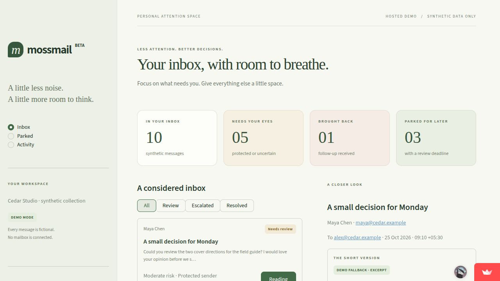
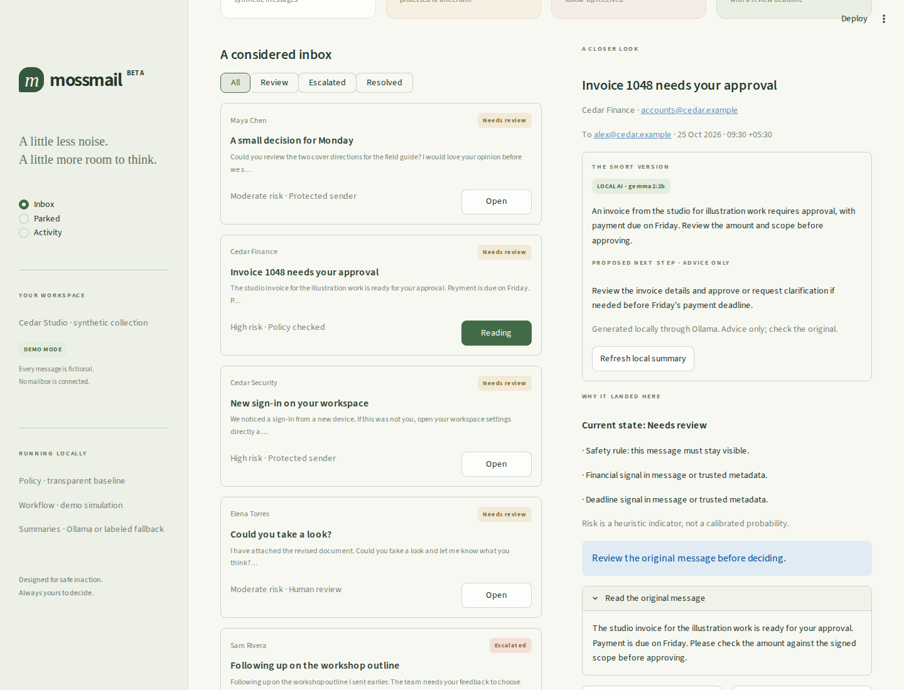
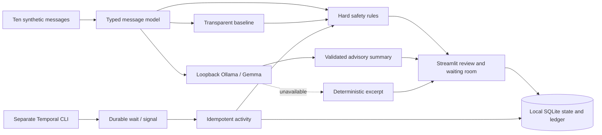
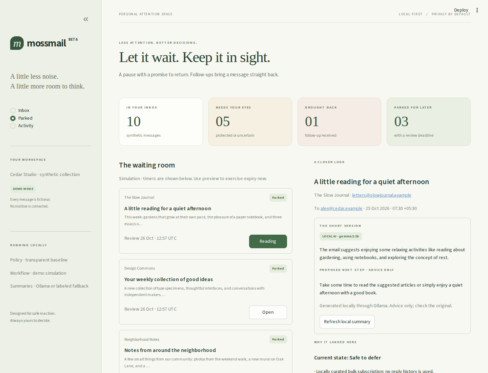
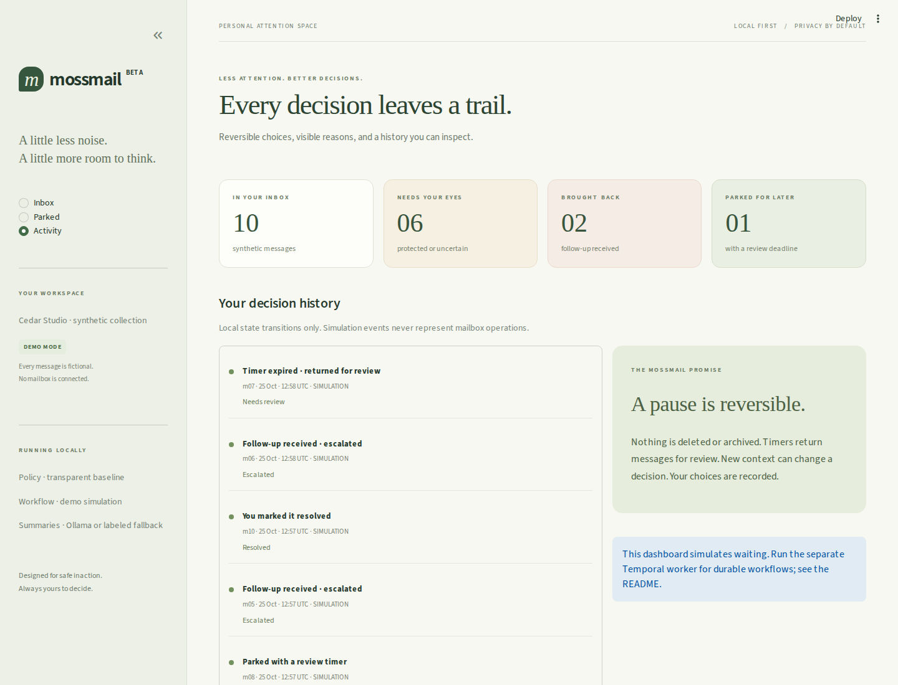

# MossMail

### A calmer inbox. Less attention, better decisions.

MossMail is a local-first email triage prototype for people whose inbox competes with their work. It makes the next decision smaller: read a short summary, understand why a message matters, and decide whether to review it now or give it some space.

**Safe inaction is the product.** Protected and uncertain messages stay visible. Low-risk subscriptions can wait with a review deadline. A follow-up brings a thread back. Nothing is sent, deleted, or archived.

[Try the live demo](https://mossmail.streamlit.app/) · [Watch the local Gemma demo](docs/mossmail-demo.webm) · [Submission draft](docs/dev-submission.md) · [Architecture](docs/architecture.md) · [Validation](docs/validation.md)



**Live on [Streamlit Community Cloud](https://mossmail.streamlit.app/).** The hosted demo uses synthetic messages, isolated visitor sessions, labeled excerpts, and simulated workflow controls. Run locally for Ollama/Gemma inference and use the separate Temporal worker for durable waiting. [Cloud deployment details](docs/streamlit-deployment.md).

## Try it locally

Python 3.12+ is required; this release was tested with Python 3.13.7. No mailbox, external account, model weights, or Temporal server is needed for the demo.

```bash
git clone https://github.com/GhananilShirpurkar/mossmail.git
cd mossmail
python3.13 -m venv .venv
source .venv/bin/activate
python -m pip install -r requirements-dev.txt
streamlit run app.py
```

Open [localhost:8501](http://localhost:8501). The initial collection contains ten fictional emails using reserved example domains, three simulated parked messages, one simulated follow-up, and one simulated user resolution. Seed events are idempotent. Your demo choices persist in `.local/mossmail.sqlite3`.

For an explicitly offline demo, run `MOSSMAIL_SUMMARIZER=fallback streamlit run app.py`. To start a separate, fresh collection without deleting existing state, set `MOSSMAIL_DB=.local/another-demo.sqlite3`.

## What works

- A responsive Streamlit inbox, review filters, a waiting room, and a local action history.
- Typed messages and independent risk policy: protected senders, financial/legal/security/urgent/deadline signals, incomplete content, attachments, uncertainty, and follow-ups.
- A transparent baseline whose explanations come from the actual rules. Risk indicators are **not calibrated probabilities**.
- Local Ollama summaries with a validated JSON schema, model/source labels, and a deterministic excerpt fallback.
- Recursive MIME preparation with charset handling, plain-text preference, safe HTML-to-text fallback, conservative quote cleanup, and original-byte preservation. This is a tested library API; the demo does not import mailboxes or accept uploads.
- SQLite transactions with unique event keys, parking-cycle checks, user overrides, and retry-safe local transitions.
- A **separate real Temporal worker and CLI** with durable timers, signals, activities, bounded retries, and history replay tests. Dashboard workflow controls are explicitly simulations.
- An optional, consent-gated **hosted** TabPFN adapter and numeric-CSV experiment CLI. It is not used by the default dashboard and has not been tested against the hosted service.



## How it works



The dashboard seeds local data, evaluates the policy, and reads persisted state. Only the selected message is summarized. The LLM produces advice; its output is never parsed into policy or mailbox commands. User actions update local state through one transactional boundary. Read the [detailed design](docs/architecture.md) for precedence, race handling, and trust boundaries.

## Local Gemma

Install [Ollama](https://ollama.com), start its local service, then optionally install the default model:

```bash
ollama pull gemma3:4b
OLLAMA_MODEL=gemma3:4b streamlit run app.py
```

MossMail checks installed models and never downloads one automatically. `gemma3:4b` is the default. **The actual demonstration used the already installed `gemma2:2b`**, selected with `OLLAMA_MODEL=gemma2:2b`; screenshots identify it. A successful call is labeled `LOCAL AI`. Missing models, connection failures, uncertain parsing, or invalid structured output produce a labeled `DEMO FALLBACK` excerpt. A fallback is not an AI summary.

Email text is untrusted. It is passed in a separate JSON data message, while the system instruction and structured-output schema remain application-controlled. Prompts alone cannot guarantee resistance to injection; the stronger boundary is architectural: the summarizer has no tools, no secrets, and no mailbox action capability. Verify summaries against the original.

## Waiting without forgetting



In the dashboard, **Simulate follow-up** reactivates a parked message and **Preview timer expiry** immediately exercises the review-on-expiry policy. The displayed deadline is part of the simulation; the dashboard does not run a background scheduler. Events say `SIMULATION`.

For real durable waiting, install the [Temporal CLI](https://docs.temporal.io/cli) and run these commands in separate terminals from the project root, with the virtual environment activated:

```bash
# Terminal 1: local server, persisted across server restarts
mkdir -p .local
temporal server start-dev --db-filename .local/temporal-server.db

# Terminal 2: separate synthetic dataset and real worker
export MOSSMAIL_DB=.local/temporal.sqlite3
python scripts/seed_temporal.py
python -m mossmail.temporal_cli worker

# Terminal 3: schedule and signal a workflow
python -m mossmail.temporal_cli start --message m06 --seconds 60
python -m mossmail.temporal_cli status --message m06
python -m mossmail.temporal_cli followup --message m06
# A different message demonstrates expiry:
python -m mossmail.temporal_cli start --message m07 --seconds 10
```

The CLI also supports `risk`, `review`, and `resolve`. The workflow persists the timer in Temporal; activities read message content from the local SQLite database. Workflow payloads contain opaque message IDs and transition metadata, never bodies or summaries. A follow-up or risk signal escalates; timeout re-evaluates current policy and returns the message for review. A current user resolution is preserved on expiry. Retried activity writes are deduplicated in SQLite. Nothing calls an email provider.

Use a dedicated database as above, not the already-parked dashboard demo database. Worker restart, signal persistence while the worker is stopped, and deterministic history replay are tested against the real SDK test server. A production server restart and multi-host deployment are not validated; a shared SQLite file is not a distributed database.



## Optional TabPFN experiment

The default baseline is local and account-free. The optional integration uses `tabpfn-client==0.6.1` and its actual `TabPFNClassifier.fit` / `predict_proba` interface. **This is hosted inference: numeric training and prediction features are sent to Prior Labs.** Feature rows exclude subjects, addresses, bodies, and identifiers, but can still reveal behavioral information.

```bash
python -m pip install -r requirements-tabpfn.txt
# Obtain your own token; do not paste it into source control.
export TABPFN_TOKEN='your-token'
export MOSSMAIL_ALLOW_HOSTED_FEATURES=true
python -m mossmail.hosted_cli /path/to/consented-risk-labels.csv \
  --consent-to-hosted-features
```

The CSV must have exactly these numeric columns in order:

```text
body_length,recipient_count,question_count,attachment,risk_signals,human_risk
```

`human_risk` must contain both 0 and 1, assigned by human risk review. Do not label messages important merely because someone replied. Supply a dataset you have permission to transmit; no real mailbox dataset is bundled. The adapter marks predictions uncalibrated, so they cannot independently authorize deferral. Hosted inference was **not run** for this release, and no accuracy or generalization claim is made. This is not a TabPFN prize entry.

## Configuration

Export variables in your shell; `.env.example` is a reference, not an auto-loaded secret file.

| Variable | Default | Purpose |
| --- | --- | --- |
| `MOSSMAIL_SUMMARIZER` | `auto` | Use installed local model; `fallback` disables inference |
| `OLLAMA_HOST` | `http://127.0.0.1:11434` | Only credential-free HTTP loopback endpoints accepted; redirects/proxies disabled |
| `OLLAMA_MODEL` | `gemma3:4b` | Explicit installed model name |
| `OLLAMA_TIMEOUT` | `45` | Local HTTP timeout in seconds |
| `MOSSMAIL_DB` | `.local/mossmail.sqlite3` | Local demo state; app resolves default from project root |
| `MOSSMAIL_PROTECTED_SENDERS` | `maya@cedar.example,security@cedar.example` | Comma-separated exact addresses, case-insensitive |
| `MOSSMAIL_DEFER_HOURS` | `24` | Greater than zero, at most 168 hours |
| `TEMPORAL_ADDRESS` | `localhost:7233` | Address for separate real worker and CLI |
| `TEMPORAL_NAMESPACE` | `default` | Temporal namespace |
| `MOSSMAIL_TEMPORAL_TESTS` | unset | `1` enables integration tests and a test-server download |
| `MOSSMAIL_ALLOW_HOSTED_FEATURES` | `false` | Hosted experiment requires `true` plus explicit CLI consent |
| `TABPFN_TOKEN` | unset | Optional hosted SDK token; never logged by MossMail |

## Checks and reproducible capture

```bash
ruff check .
ruff format --check .
pytest -q
# First run downloads the Temporal time-skipping test server; no account or weights required.
MOSSMAIL_TEMPORAL_TESTS=1 pytest -q tests/test_temporal.py
```

The default suite is fully offline. See [validation evidence](docs/validation.md). `requirements.lock.txt` records the complete tested development environment; install it with `python -m pip install -r requirements.lock.txt` for exact package versions.

For screenshots and a genuine silent browser recording:

```bash
python -m playwright install chromium ffmpeg
# Terminal 1: use a new filename for each capture run
OLLAMA_MODEL=gemma2:2b MOSSMAIL_DB=.local/new-capture.sqlite3 \
  streamlit run app.py --server.port 8502
# Terminal 2
python scripts/capture_demo.py --url http://127.0.0.1:8502
```

If that model is absent, the capture truthfully shows the fallback. The script navigates the real UI and changes synthetic local state. It does not fabricate a screenshot or model result. [Capture notes](docs/demo.md) explain the sequence.

## Privacy, limitations, and roadmap

There is **no Gmail/Outlook connection, live synchronization, mail sending, deletion, or archival**. The local app binds to loopback and has no multi-user authentication. The hosted `streamlit_app.py` demo uses only bundled synthetic data and a separate temporary database for each visitor session. Session changes are disposable; the hosted demo is not a mailbox service. Local SQLite is not encrypted. The supplied collection and captures are entirely synthetic.

Streamlit usage statistics are disabled. No Sentry or third-party message telemetry is initialized. Inference failures log only a fixed event code, not exception bodies, prompts, email content, or addresses. Original MIME bytes are retained by the parser result, not automatically logged or uploaded. Using a hosted scorer is a separate explicit opt-in.

English keyword rules miss paraphrases, other languages, images, attachments, and subtle context, and can overflag harmless mail. Sender protection is a local preference, **not sender authentication**. Trusted-bulk status comes only from curated local metadata, never an instruction in email text. Unknown messages default to review, but these safeguards are not a guarantee of semantic correctness. The current product is a synthetic-data prototype, not a production email filter.

Next: authenticated read-only mailbox import, attachment-aware review, evaluation on permissioned human risk labels with temporal/thread-aware splits, signal reconciliation after a workflow completes, and a reviewed UI-to-Temporal bridge. Those features are planned, not shipped. No user study, measured time saving, or model benchmark is claimed.

## License and provenance

MossMail's original source, synthetic examples, visual styling, and genuine application captures are released under [MIT](LICENSE). Model weights and dependencies retain their own licenses; no model weights are distributed here.

Inspiration: Khushighosh's [Let It Die article](https://dev.to/khushighosh/let-it-die-the-lazy-email-agent-on-tabpfn-gemma-and-temporal-10o0) and [MIT-licensed repository](https://github.com/Khushighosh/let-it-die). The upstream README, license, and Python implementation were inspected at commit `ed4415ba00deea76d366f8d22c6ddadcab6c8437` before implementation. The public article fetch was blocked, so implementation observations are grounded in the repository.

MossMail was written independently with Codex assistance. No upstream source file, dataset, predictions, cache, credentials, or Git history was copied. The conceptual influence—local Gemma summaries plus a deferred-message workflow—is credited explicitly. Original work includes the dashboard, risk-first policy, typed models, MIME parser, structured inference boundary, event ledger, consent gates, workflow controls, and tests. [Upstream review](docs/upstream-review.md) records the differences and licensing check.
