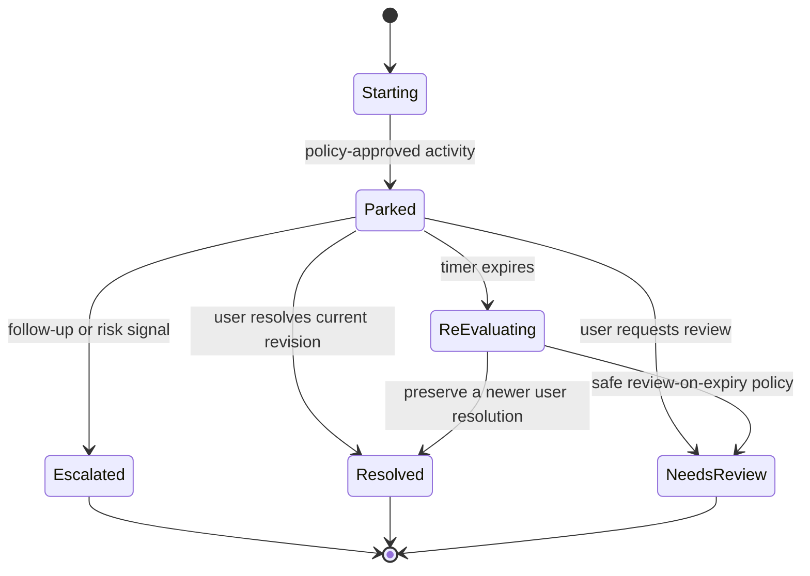

# Architecture and safety boundaries

MossMail is a single-user local prototype. Its two execution paths are deliberately explicit: a fully usable Streamlit simulation and a real Temporal worker exercised through the CLI and integration tests.

## Modules

| Module | Responsibility |
| --- | --- |
| `models.py` | Validated message, score, decision, override, and summary schemas |
| `policy.py` | Protected senders, configurable time limits, normalized risk detection |
| `scoring.py` | Transparent baseline and opt-in hosted TabPFN adapter |
| `decision_engine.py` | Pure policy decision with explanations and review deadlines |
| `email_parser.py` | MIME/charset extraction, latest-reply preparation, original preservation |
| `summarizer.py` | Local-only HTTP inference, schema validation, truthful fallback |
| `storage.py` | SQLite state and atomic idempotent event ledger |
| `workflows.py` | Deterministic Temporal state machine, timer, signals, retry policy |
| `activities.py` | Local state side effects, policy rejection, no mailbox operations |
| `temporal_cli.py` | Worker and workflow lifecycle commands |
| `hosted_cli.py` | Explicit numeric-feature experiment, separate from dashboard |

## Decision precedence

1. A user choice for the current message revision wins, except a deferral that violates protection or incomplete-content guards. Explicit resolution is allowed and remains available in the resolved filter.
2. A follow-up or risk signal increments the revision, clears the old override, and escalates. A person can resolve that new revision afterward.
3. Protected senders or urgent, financial, legal, security, and deadline evidence keep mail visible, even if a model score is low.
4. Only curated bulk messages with readable, complete text and both low risk and low uncertainty can be automatically recommended for deferral.
5. Everything else goes to review. Lack of a reply is never evidence of unimportance.

Scores and explanations describe the initial recommendation; persisted events describe the current state. The UI shows both when timer expiry changes that state. A `Safe to defer` recommendation is distinct from `parked=true`, which means a local simulated or Temporal activity has actually recorded a waiting period.

## Waiting state machine

`BEGIN IMMEDIATE` serializes local transitions. A unique event key makes a retried write return the prior result. Each parking cycle has a generation number; stale workflow actions cannot mutate a newer cycle. This gives idempotent **local database effects**, not exactly-once email delivery or archival. Activities retry at most five times with 15-second execution and three-minute total limits. Policy rejections are non-retryable. A version counter catches signals delivered during a terminal activity; newer signals receive their own idempotency key before the workflow completes.

Temporal receives opaque IDs and transition commands. The activity resolves content locally and re-evaluates current policy when the timer expires. The dashboard never pretends to have scheduled a Temporal workflow. A signal after a workflow has completed requires application-level reconciliation; no live mailbox listener exists in this version.

## Untrusted data and privacy

Mail is data, not instructions. The parser excludes attachments and nested forwarded messages from the current body, prefers plain text, and flags uncertain HTML/charset/quote cases. It retains original bytes and full extracted text. The latest short reply is not replaced by a longer old forward merely to meet a minimum length. Ambiguous parsing returns to human review.

Ollama must use a loopback HTTP origin. Redirects and environment proxies are disabled. Prompt instructions and JSON validation reduce malformed output, but do not prove factual accuracy or defeat every injection. The policy never consumes the summary, and the inference module has no action tools. Model text is rendered as plain text.

The local database contains synthetic email bodies and metadata. It is excluded from Git and is not encrypted. Event entries contain message IDs, modes, timestamps, actions, and state, not bodies or addresses. Logging uses a fixed inference-failure code. The optional hosted feature path cannot run without consent; its probabilities are treated as uncalibrated and cannot authorize parking on their own.

## Evaluation boundary

The tests validate software behavior and safety invariants on synthetic cases. They are not an estimate of real-mail classification accuracy. There is no training dataset, accuracy figure, or measured time saving in this release. A future evaluation must use permissioned risk labels, completed observation windows, chronological splits, and sender/thread leakage controls, and must report false suppression of high-risk mail separately.
